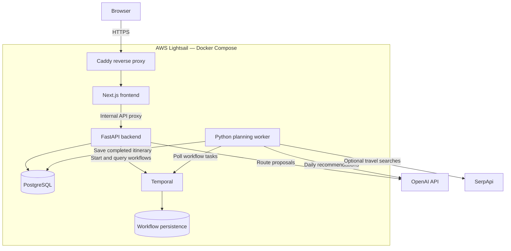

# Voyage — AI Travel Planner

**[Try the live app → myvoyageplanner.com](https://myvoyageplanner.com/)**

Voyage turns destinations, travel dates, budgets, and preferences into a personalized daily itinerary. I built the project across the full application lifecycle: interface design, backend APIs, AI integration, background workflows, database persistence, testing, and deployment to AWS.

This repository showcases the application and its architecture. Application source code is maintained separately in a private repository.

## Try it

1. Open **[myvoyageplanner.com](https://myvoyageplanner.com/)**.
2. Choose destinations, dates, a budget, and travel preferences.
3. Review the proposed route and start itinerary generation.
4. Follow planning progress and explore the resulting daily itinerary.

The site is a portfolio demo with no account requirement or individual trip privacy. Use fictional travel details. Generation depends on external API availability and may take several minutes. Recommendations and prices are estimates or retrieved offers, not reservations.

## Features

- Multi-destination routes with destination ordering and night allocation.
- Personalized daily recommendations based on budget, interests, travel style, and pace.
- City and airport autocomplete backed by bundled location data.
- Background itinerary generation with progress reporting and retry support.
- Transport, accommodation, activities, and estimated costs in one itinerary.
- Optional flight and hotel search integration, with labeled estimates when live offers are unavailable.
- Persistent trip records and generated itineraries in PostgreSQL.
- Responsive desktop and mobile interface.

## Technology stack

| Area | Technologies | Purpose |
| --- | --- | --- |
| Frontend | Next.js, React, TypeScript | Planning forms, itinerary views, and same-origin API proxy |
| UI | Material UI, Emotion, Day.js | Responsive components, styling, and date handling |
| Backend | Python, FastAPI, Pydantic | HTTP APIs, request validation, and structured response models |
| Database | PostgreSQL, SQLAlchemy, psycopg | Trip persistence, JSONB itinerary storage, and transactions |
| Migrations | Alembic | Versioned schema updates before application rollout |
| Background workflows | Temporal, Temporal Python SDK | Workflow history, activity retries, progress queries, and recovery checkpoints |
| AI | OpenAI API, structured outputs | Route proposals, daily recommendations, and itinerary narrative |
| Travel search | SerpApi | Optional Google Flights and Hotels offer retrieval |
| Location data | GeoNames cities, airportsdata | Local city and airport autocomplete |
| Containers | Docker, Docker Compose | Independent web, API, and worker images with application dependencies |
| Live hosting | AWS Lightsail, Caddy, Cloudflare DNS | Server hosting, HTTPS reverse proxy, and custom domain routing |
| CI and image publishing | GitHub Actions, GitHub Container Registry | Automated checks and publication of versioned container images |
| Deployment automation — planned | GitHub Actions | Deploy validated changes to Lightsail and check application health |
| Kubernetes implementation | Kubernetes, Helm, kind, Argo CD | Locally validated orchestration, migration hooks, and manual GitOps synchronization |
| Testing and static checks | pytest, Playwright, Node test runner, Ruff, ESLint, TypeScript | Backend behavior, browser flows, API proxy, and code quality |

## Architecture

The browser communicates through the Next.js application. FastAPI validates requests and persists trips, while a separate worker performs long-running planning through Temporal. PostgreSQL stores application data; Temporal maintains workflow execution history separately. Provider credentials remain on the server.

## Engineering decisions

**Keep planning outside HTTP requests.** Itinerary generation involves multiple external calls. Temporal coordinates background activities with timeouts, bounded retries, and progress queries, while the UI polls for updates.

**Validate AI output with application rules.** Structured outputs provide a schema, while Python checks trip dates, destination allocation, schedules, and budget calculations. Required planning failures are surfaced rather than recorded as successful empty itineraries.

**Make completion transactional.** The generated itinerary and completed trip status are saved in one database transaction. Stable workflow IDs reuse active runs, and completed plans can be returned without generating them again.

**Recover useful work.** Planning activities checkpoint successful city batches so retries can reuse completed work. Optional enrichment has explicit retry or fallback behavior.

**Keep services independently deployable.** The web, API, and worker have separate container images. The browser uses a same-origin proxy, and the frontend receives no database or provider credentials.

## Delivery and infrastructure

**Current live deployment:** Docker Compose on a single AWS Lightsail instance, behind Caddy with HTTPS at **[myvoyageplanner.com](https://myvoyageplanner.com/)**. Updates are currently deployed manually through SSH.

**Implemented CI:** GitHub Actions runs linting, type checks, automated tests, builds, and infrastructure validation. A separate workflow publishes three container images to GitHub Container Registry after successful main-branch CI. Image publication does not currently update the live server.

**Next deployment milestone:** Extend GitHub Actions to deploy validated changes to Lightsail, verify service health, and support a documented rollback procedure.

**Additional infrastructure work:** Implemented and locally validated a Helm-based Kubernetes deployment on kind, including migration Jobs, health probes, resource limits, Secret references, and container security settings. Argo CD fetched the source repository and completed a manual synchronization. Kubernetes and Argo CD are separate from the current Lightsail Compose deployment.

## Verification

Recorded local validation includes:

- 49 API tests and 77 worker tests.
- 32 Playwright desktop/mobile browser tests.
- 7 location-search tests and an API proxy test.
- Python linting, frontend linting, TypeScript checks, and production image builds.
- Helm rendering and Kubernetes schema validation.
- A local infrastructure smoke test through the web proxy, API, PostgreSQL, Temporal, and worker, producing a persisted itinerary with synthetic providers.
- Persistence checks across Helm upgrades and a manual Argo CD synchronization.

These results describe the tested development revision, not a load test or a guarantee of production availability.

## Next steps

- Automatic deployment to AWS Lightsail through GitHub Actions.
- User accounts and authorization for individual trips.
- Separate development and live environments.
- Production Temporal configuration and tested backup restoration.
- Application usage controls and improved operational monitoring.

## About this repository

This public repository documents Voyage for portfolio review. The application is under active development; its implementation and credentials are not included here.

Built by **[hysteven1](https://github.com/hysteven1)**.
